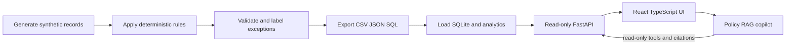
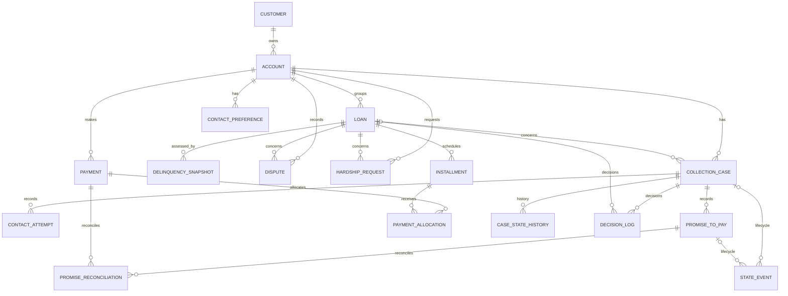
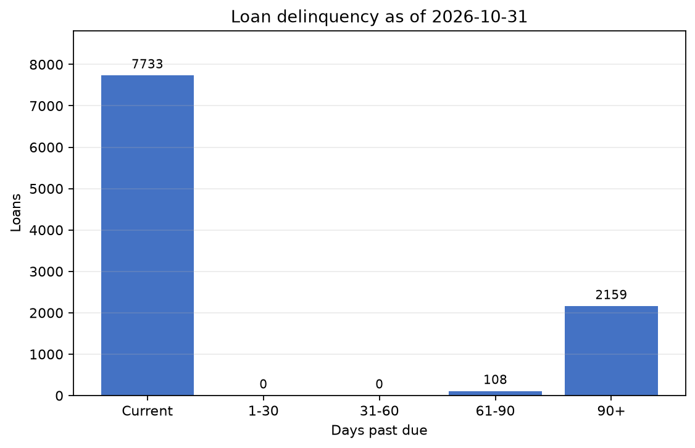
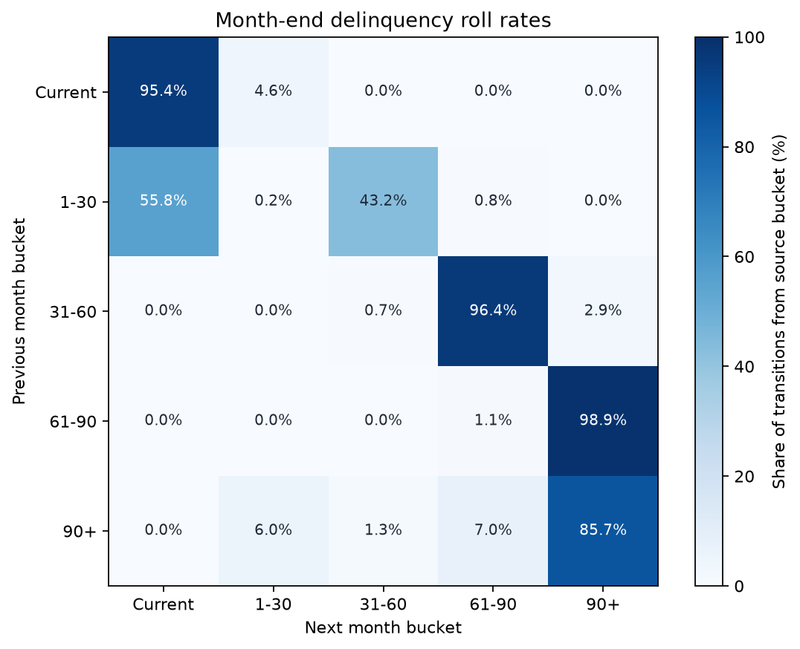
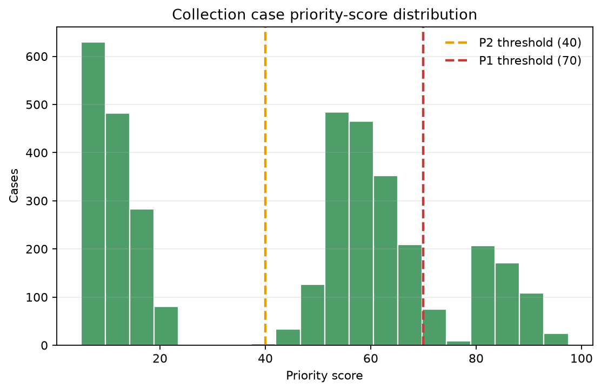
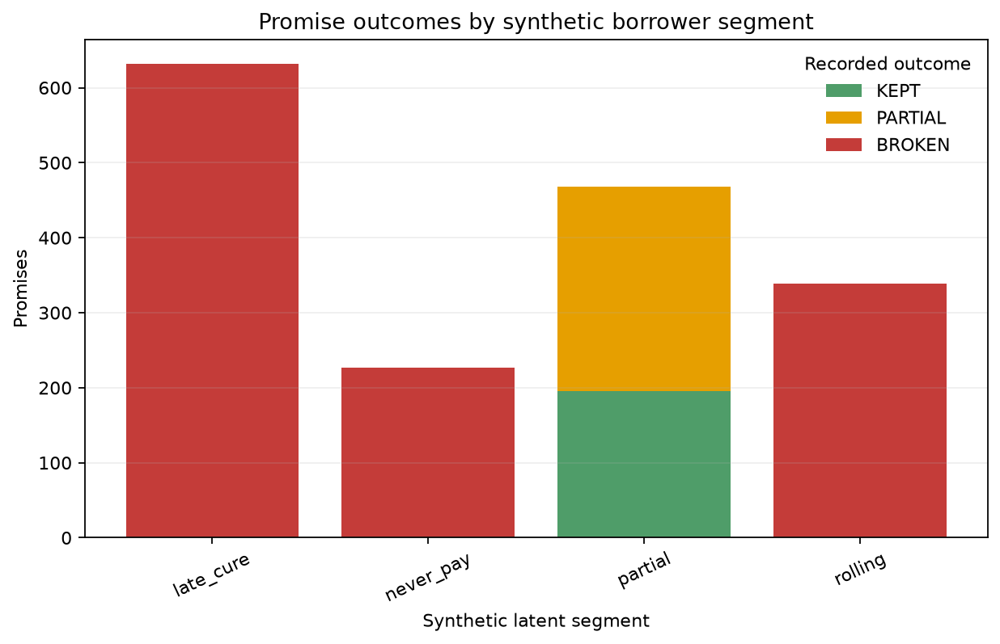
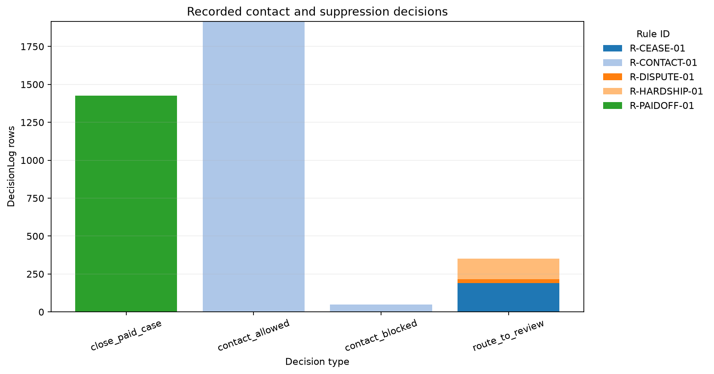
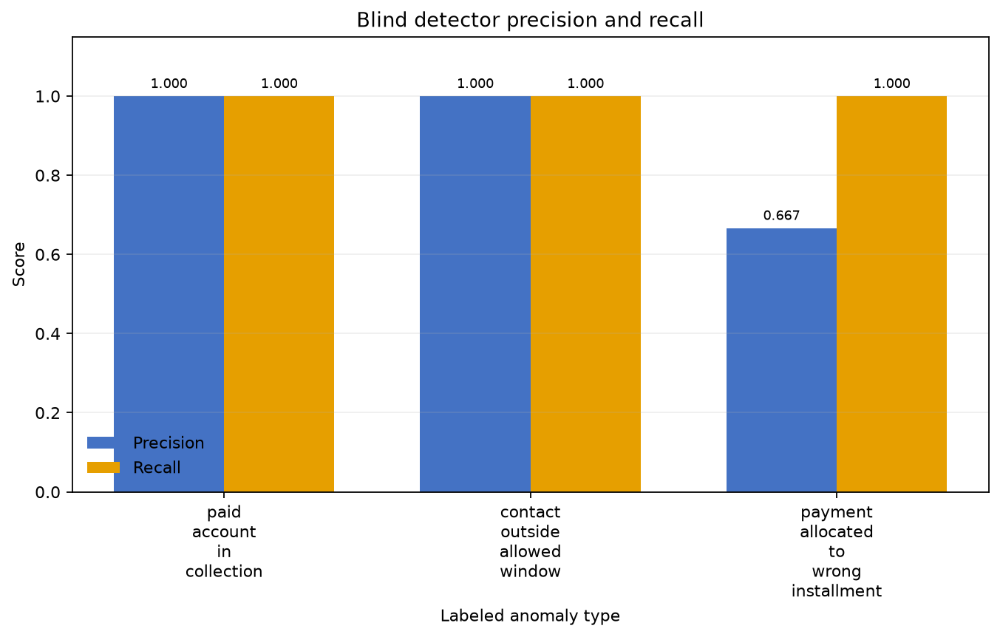
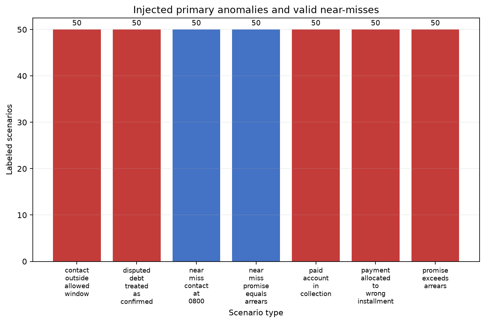

# Yottaflex Debt Collection & Workflow Engine

A reproducible synthetic workflow for prioritizing overdue accounts, enforcing contact rules, tracking promises, and surfacing exceptions, without sending customer communications.

## Results at a glance

| Measure | Observed result |
|---|---:|
| Loans | 10,000 |
| Installments | 30,000 |
| Payments | 27,155 |
| Collection cases | 3,742 |
| Promises | 1,666 |
| Injected primary anomalies | 250 (50 per anomaly type) |
| Valid near-misses | 100 (50 per boundary type) |
| Tests | 68 passed; 482 subtests passed |
| Integrity validation | All checks passed (6 implementation classes covering the brief's 7 Step 8 items) |
| Reproducibility | Yes: 22 of 22 file checksums matched across two runs |
| AI evaluation | 18 of 18 passed (printed by the evaluator) |

Sources: `data/full/manifest.json`, `ground_truth/full/ground_truth.csv`, `docs/validation_summary.md`, and the commands in [Quickstart](#quickstart).

## Quickstart

Verified environment: Python 3.14.2 and Node.js v22.17.1 (the package declares Python >=3.10). The full test suite took 48.28 seconds in the recorded run. Data-generation time was not measured. Docker is not installed on the submission laptop, so the local path below is the verified one.

```bash
python -m pip install -e ".[dev]"
python -m pip install matplotlib
python -m yottaflex_debt_collection --dataset full --loans 10000 --seed 20261022 --anomaly-rows 50
python -m yottaflex_debt_collection.database --data-dir data/full --ground-truth-dir ground_truth/full --db data/full/collection.sqlite --overwrite
```

Run the API and UI in separate terminals, then open `http://127.0.0.1:5173`:

```bash
python -m yottaflex_debt_collection.api
npm --prefix ui run dev
```

The UI dev command was tested with dependencies already present. GNU Make was unavailable in the validation environment, so each target was run through its underlying Python command. On a host with GNU Make:

```bash
make setup
make data
make validate
make db-load
make test
make repro
make detect
make evaluate
make eval-ai
make readme-assets
```

## Generator

Full-dataset command (run and verified; equivalent to `make data`):

```bash
python -m yottaflex_debt_collection --dataset full --loans 10000 --seed 20261022 --anomaly-rows 50
```

The seed is `20261022` and the fixed as-of date is `2026-10-31`, with no wall-clock calls. `--loans` scales the portfolio, and each loan has three scheduled installments. Inputs are exported under `data/full/`. Anomaly labels and expected decisions are kept separately under `ground_truth/full/`. See [Generation details](docs/GENERATION.md).

## Architecture





The diagram follows [`schema/schema.sql`](schema/schema.sql). [`docs/ER.md`](docs/ER.md) describes cardinality and optional relationships.

## Business rules

| Rule ID | Implemented behavior |
|---|---|
| `R-CASE-01` | Open a case when DPD first reaches the configured threshold of one day. |
| `R-SCORE-01` | `100 × (0.40 × normalized arrears + 0.35 × normalized DPD bucket + 0.25 × normalized customer risk)`. P1 starts at 70, P2 at 40. |
| `R-CONTACT-01` | Contact window defaults to 08:00–19:00 in the customer's local time. |
| `R-CONTACT-02` | At most three sent attempts or reserved tasks per account in a rolling seven-day period; reservations count. |
| `R-CONTACT-03` | Synthetic attempt outcomes follow the configured case-sequence cycle, independently of latent labels. |
| `R-PROMISE-01` | A connected attempt may create a promise for 70% of verified promise-date arrears, due seven days later. |
| `R-RECON-01` | Reconcile eligible payments with a 5% amount tolerance and a two-day grace period. |
| `R-ALLOC-01` | Allocate posted payments to the oldest due installment first, allowing partial allocation. |
| `R-DISPUTE-01` | Suppress dunning for disputed or under-review debt and route it for review. |
| `R-HARDSHIP-01` | Pause automated outbound contact for requested or approved hardship. |
| `R-CEASE-01` | Block outbound contact for an active cease-contact instruction and route for review. |
| `R-PAIDOFF-01` | Exclude paid-off loans from collection and flag an open case for review. |

Parameters come from [`config/policy.yaml`](config/policy.yaml). Contact windows and caps are configurable example defaults, not legal advice or a statement of regulatory requirements. Review them with qualified compliance counsel.

## Results and graphs

Charts are generated from the fixed-seed CSV/SQLite outputs and the detector report. Segment and anomaly labels are used only in these offline reporting charts.

To reproduce the detector inputs:

```bash
python -m yottaflex_debt_collection.detectors --data-dir data/full --output reports/detections.csv                 # make detect
python -m yottaflex_debt_collection.evaluation --detections reports/detections.csv --ground-truth ground_truth/full/ground_truth.csv --report reports/detector_metrics.md   # make evaluate
python scripts/make_readme_assets.py                                                                              # make readme-assets
```

### Delinquency distribution



The latest snapshot has 7,733 current loans, 108 in the 61–90 bucket, and 2,159 over 90 days past due (21.6%). The 1–30 and 31–60 buckets are empty, so this is not a realistic portfolio shape. The cause has not been investigated. It comes from the synthetic payment segments and is listed in [Limitations](#limitations).

### Month-end roll rates



Rates are row-normalized transitions between successive month-end buckets. In this sample, 85.7% of transitions from 90+ remain there. These come from synthetic cohorts and are not forecasts.

### Case priority scores



The histogram shows all generated cases, with configured thresholds at 40 and 70. The sample has 590 P1, 1,677 P2, and 1,475 P3 cases.

### Promise outcomes by latent segment



Segment labels are used for reporting only. Outcomes follow the existing payment records, and the generator does not make a promise cause a payment. Segments without a recorded promise do not appear.

### Contact and suppression decisions



DecisionLog records grouped by decision type and rule ID. This is an audit view of generated decisions, not evidence that the policy is legally sufficient.

### Blind-detector precision and recall



Only three of the five injected anomaly types have detectors: paid account in collection, contact outside allowed window, and wrong-installment allocation. Disputed debt treated as confirmed and promise exceeding arrears are not scored by a detector. Measured precision is 1.000, 1.000, and 0.667 respectively. Recall is 1.000 for all three against injected primary labels.

The 25 extra wrong-allocation detections are downstream spillovers in loans with an injected wrong-allocation case. Changing an earlier allocation changes remaining balances, but later allocation rows are not regenerated. They count as false positives against primary-only ground truth even though the detector identifies real follow-on rule violations. Injected scenarios and their spillovers do not establish detector performance on independent or real-world data.

**Valid near-misses flagged by detectors:** Near-miss rows: 100; flagged by detectors: 50

### Injected anomalies and near-misses



The full run has 50 primary examples of each of five anomaly types and 50 of each of two valid near-miss types. Counts come from primary rows in `ground_truth/full/ground_truth.csv`, not from detector features.

## Data quality and ground truth

The five injected anomalies are: paid account still in collection, contact outside the allowed window, payment allocated to the wrong installment, promise exceeding arrears, and disputed debt treated as confirmed. The two valid near-misses are a contact at exactly 08:00 and a promise equal to arrears. The manifest records 50 requested examples per type, and the generated primary labels confirm these counts. Detectors cover three of the five anomalies.

`ground_truth/` is separate from the model-input CSV exports. The label-isolation regression test is `tests/test_integrity_detectors.py::test_blind_detector_module_cannot_reference_label_locations`, and it passed in the full suite. Detector metrics use primary labels only and exclude derived-recalculation labels. High recall on injected examples is not independent validation, because the generator and detectors share the underlying rules.

| Detector type | Precision | Recall | F1 |
|---|---:|---:|---:|
| Paid account in collection | 1.000 | 1.000 | 1.000 |
| Contact outside allowed window | 1.000 | 1.000 | 1.000 |
| Payment allocated to wrong installment | 0.667 | 1.000 | 0.800 |

## Validation and reproducibility

The brief's seven Step 8 validation items map to these results:

| Validation item | Result | Evidence |
|---|---|---|
| Primary-key uniqueness | Pass | Integrity CLI, no errors |
| Foreign-key integrity | Pass | Integrity CLI, no errors |
| Allowed enums | Pass | Integrity CLI, no errors |
| Date parsing and ordering | Pass | Integrity CLI, no errors |
| Arithmetic reconciliation | Pass | Integrity CLI, no errors |
| Lifecycle transitions and consistency | Pass | Integrity CLI, no errors |
| Duplicate checks | Pass | Duplicate primary and composite keys are caught in the primary-key check. `test_integrity_checks_generated_files_and_detects_duplicate_key` verifies rejection. |

The integrity CLI reported `valid: true`, six implementation check classes passed, and an empty error list. Duplicate-ID validation is part of primary-key uniqueness, so the seven items are not seven independent counters. For reproducibility run `make repro`. The recorded full-scale run generated the dataset twice with seed `20261022`, matched row counts, and matched SHA-256 checksums for all 22 exported files. See [`docs/validation_summary.md`](docs/validation_summary.md).

## API and UI

| Method | Path | Purpose |
|---|---|---|
| GET | `/health` | SQLite health and foreign-key status |
| GET | `/queue` | Ranked open-case queue |
| GET | `/cases/{case_id}` | Case, account/customer, loan, latest snapshot |
| GET | `/cases/{case_id}/timeline` | State, contact, promise, reconciliation events |
| GET | `/decisions` | DecisionLog entries, optionally filtered by case |
| GET | `/exceptions` | Ground-truth-blind detector output |
| GET | `/metrics` | Roll rates, promise metrics, cure rate, rule violations, queue count |
| GET | `/admin/policy` | Current policy configuration |
| GET | `/admin/validation` | Dataset integrity results |
| GET | `/admin/manifest` | Dataset manifest and checksums |
| POST | `/copilot/chat` | Policy-grounded answer with citations and read-only tools |
| POST | `/copilot/check-outreach` | Deterministic outreach-text guardrail check |

UI screens: priority queue, case detail and timeline, compliance and metrics, and read-only administration.

<!-- Screenshots: add docs/img/ui_queue.png, ui_case.png, ui_compliance.png, then uncomment


-->

## AI copilot

BM25 retrieval indexes policy and documentation chunks with rule-ID and document citations. Four fixed read-only tools retrieve case facts, score breakdowns, blocked contacts, and promise status, and none accepts raw SQL. Deterministic guardrails reject threatening, abusive, third-party-disclosing, or missing-dispute-notice drafts.

**The LLM only explains; scoring, scheduling and compliance are deterministic.** Without `OPENAI_API_KEY`, a local template fallback works offline. The golden-question evaluation passed 18 of 18. It tests retrieval and template behavior, not hosted-model reliability. See [`docs/AI.md`](docs/AI.md).

## Tests

```bash
python -m pytest -q
```

Recorded result: 68 passed, 482 subtests passed. Coverage includes generation, ID and schema rules, integrity and label isolation, detector evaluation, SQLite analytics and API, demo output, and copilot guardrails and retrieval. See [`docs/coverage_report.md`](docs/coverage_report.md).

## Repository layout

```text
config/                          policy rules
data/full/                       generated CSV, JSON, SQL, manifest, SQLite
ground_truth/full/               isolated labels and expected decisions
schema/                          data dictionary and SQL schemas
src/yottaflex_debt_collection/   generator, rules, API, database, copilot
scripts/                         README chart generation
tests/                           unit, integration, evaluation tests
tools/                           generation, repro, evaluation, demo commands
ui/                              React + TypeScript frontend
docs/                            design, validation, coverage, charts
```

## Assumptions and open questions

- The brief's `CTP-<case-id>-001` ID is treated as a ContactAttempt ID. Confirm this with the intended owner.
- The target volume implies three installments per loan.
- The as-of and generation dates are fixed to `2026-10-31`.

All tracked assumptions are in [`docs/ASSUMPTIONS.md`](docs/ASSUMPTIONS.md).

## Limitations

- All records and behavior distributions are synthetic assumptions, not portfolio estimates.
- The delinquency distribution is skewed: the 1–60 DPD buckets are empty and about 21.6% of loans are 90+ DPD. This comes from the generator's payment segments and is not realistic portfolio data.
- Payments follow latent behavior independently of promises. Promises reconcile against payments and do not cause them.
- Only three of five injected anomaly types have detectors. Recall is measured on injected, rule-shaped examples and does not establish real-world recall.
- Wrong-allocation precision includes 25 downstream spillover detections not labelled as primary anomalies.
- No real communications are sent, and there is no production auth or payment integration.
- The sample policy needs jurisdiction-specific review.
- Docker is not installed on the submission laptop and was not part of local verification.

## Provenance and licence

Fully synthetic data, with no external sources and no personal information. See [`SOURCE_MANIFEST.md`](SOURCE_MANIFEST.md). Licensed under MIT. See [`LICENSE`](LICENSE).