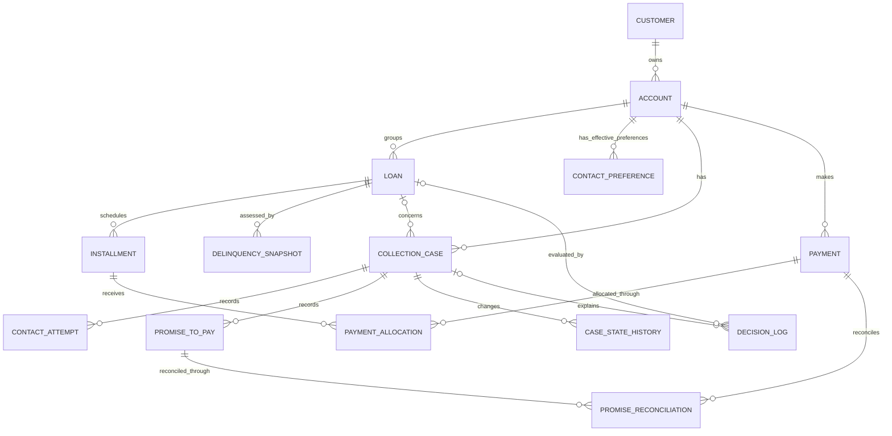

# Entity relationships and cardinality

In the diagram, `||` means exactly one, `o|` means zero or one, and `o{` means zero or many. Child rows require their non-optional parent by foreign key; nullable foreign keys are called out below.

| Parent → child | Parent cardinality | Child cardinality | Optional relationship / constraint |
|---|---:|---:|---|
| Customer → Account | 0..N accounts | exactly 1 customer | An account cannot exist without its customer. |
| Account → Loan | 0..N loans | exactly 1 account | A loan cannot exist without its account. |
| Loan → Installment | 0..N installments | exactly 1 loan | Installments are generated from a loan schedule. |
| Loan → DelinquencySnapshot | 0..N snapshots | exactly 1 loan | A loan may have no snapshot yet. |
| Account → ContactPreference | 0..N effective-dated rows | exactly 1 account | An account may have no recorded preference; `effective_from`/`effective_to` preserve history. |
| Account → CollectionCase | 0..N cases | exactly 1 account | A case always belongs to an account. |
| Loan → CollectionCase | 0..N historical cases; at most 1 with `status = 'open'` | 0..1 loan | `collection_case.loan_id` is nullable for account-level cases; a partial unique index prevents two open cases for one loan. |
| CollectionCase → ContactAttempt | 0..N attempts | exactly 1 case | Policy-blocked actions are retained as events, not sent contacts. |
| CollectionCase → PromiseToPay | 0..N promises | exactly 1 case | A case may have no commitment. |
| Payment ↔ Installment via PaymentAllocation | 0..N allocations | 0..N allocations | N:M bridge; each allocation references exactly one payment and one installment. |
| PromiseToPay ↔ Payment via PromiseReconciliation | 0..N reconciliations | 0..N reconciliations | N:M bridge; supports partial payments and multiple payments per promise. |
| CollectionCase → CaseStateHistory | 0..N history events | exactly 1 case | Append-only lifecycle history. |
| CollectionCase → DecisionLog | 0..N decisions | 0..1 case | `decision_log.case_id` is nullable for decisions not scoped to a case. |
| Loan → DecisionLog | 0..N decisions | 0..1 loan | `decision_log.loan_id` is nullable for decisions not scoped to a loan. |
| Account → Payment | 0..N payments | exactly 1 account | A payment is recorded against one account. |

`ContactPreference` is effective-dated (`effective_from`, optional `effective_to`); changes are stored as new rows rather than overwriting prior preferences. `CaseStateHistory`, `DecisionLog`, `ContactAttempt`, and the reconciliation bridges retain event and allocation history. `schema/schema.sql` is hand-maintained PostgreSQL DDL with explicit primary/foreign keys, enum checks, and foreign-key indexes. The YAML data dictionary records field metadata and relationship references.
